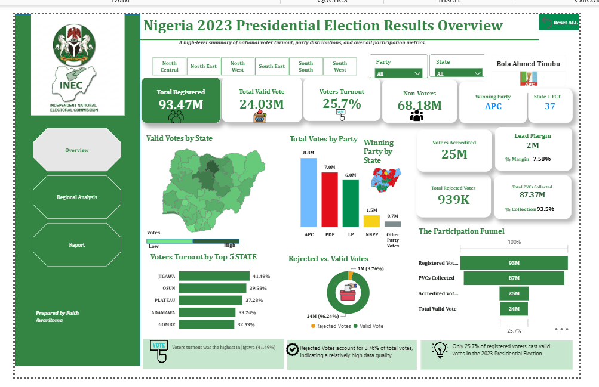
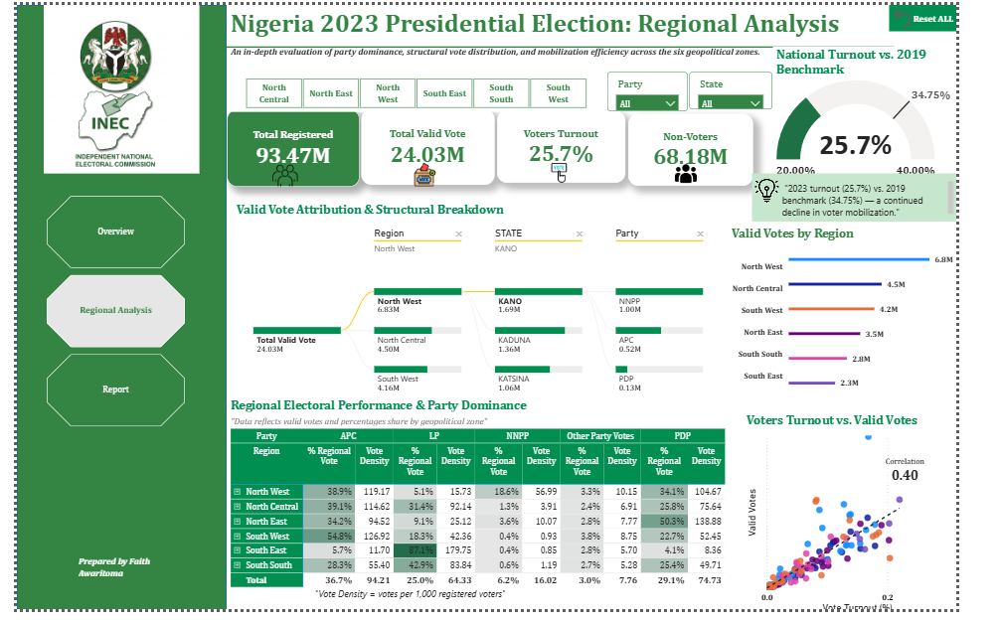
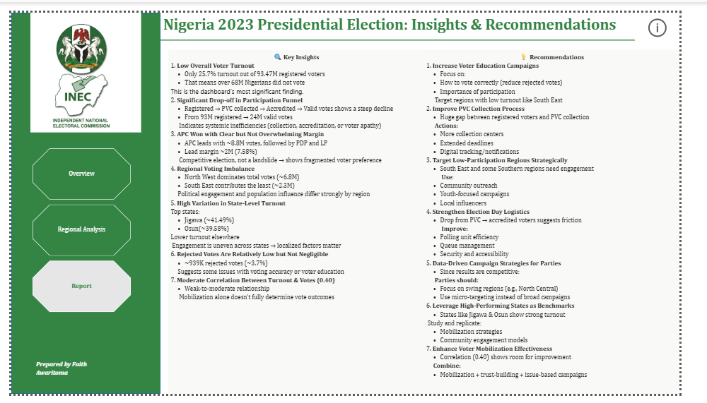
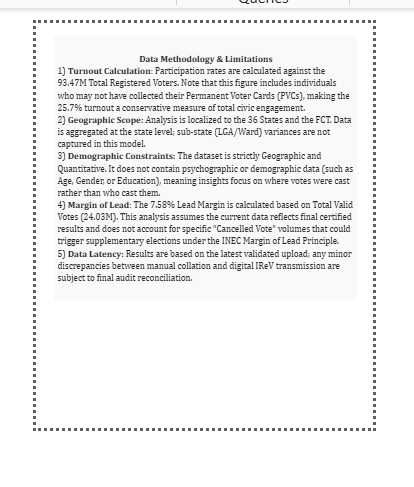

#  Nigeria 2023 Presidential Election Results Dashboard

An interactive **Power BI** dashboard analysing voter turnout, party performance and participation gaps across Nigeria's 36 states, the FCT and the six geopolitical zones in the 2023 Presidential Election.

---

## 📌 Project Overview

Only **1 in 4 registered Nigerians** cast a valid vote in 2023. This dashboard asks three questions:

1. **How many people actually participated**, and where did voters drop off between registration and the ballot?
2. **Which parties dominated which regions**, and how competitive was the race?
3. **What can INEC, civil society and political parties do** to raise participation in future elections?

## 🛠️ Tools & Skills

| Tool | Used for |
|---|---|
| **Power BI Desktop** | Data modelling, visuals and interactivity |
| **Power Query** | Data cleaning and transformation |
| **DAX** | Measures for turnout, lead margin, vote density, rejection rate and PVC collection rate |
| **Design** | INEC-themed layout, page navigation buttons, slicers and a "Reset All" bookmark |

## 📊 Dashboard Pages

### 1. Overview
National KPIs (registered voters, valid votes, turnout, non-voters, winning party, lead margin, rejected votes and PVC collection), plus valid votes by state (map), total votes by party, the top 5 states by turnout, rejected vs valid votes, and the participation funnel.

### 2. Regional Analysis

A decomposition tree (Region → State → Party), valid votes by geopolitical zone, a regional party-dominance matrix with **vote density** (votes per 1,000 registered voters), a gauge comparing 2023 turnout with 2019, and a turnout vs valid votes scatter plot.

### 3. Insights & Recommendations

### 4. Methodology & Limitations

---

## 🔢 Key Metrics

| Metric | Value |
|---|---|
| Total Registered Voters | **93.47M** |
| PVCs Collected | **87.37M** (93.5%) |
| Voters Accredited | **25M** |
| Total Valid Votes | **24.03M** |
| Voter Turnout | **25.7%** (vs 34.75% in 2019) |
| Non-Voters | **68.18M** |
| Rejected Votes | **939K** (3.76%) |
| Winning Party | **APC** (Bola Ahmed Tinubu) |
| Lead Margin | **~2M votes** (7.58%) |

## 💡 Key Insights

- **Low turnout:** Only 25.7% of registered voters cast a valid vote, so more than 68M Nigerians did not vote. This continues the decline from 34.75% in 2019.
- **Steep participation funnel:** Voters dropped from 93M registered to 87M with PVCs, then sharply to 25M accredited. The biggest loss happens **between collecting a PVC and turning up to vote**.
- **Competitive race:** APC won with ~8.8M votes, ahead of PDP (7.0M) and LP (6.0M). The ~7.58% margin points to fragmented voter preference rather than a landslide.
- **Regional imbalance:** The North West contributed the most valid votes (6.8M) and the South East the fewest (2.3M).
- **Strong regional strongholds:** LP took **87.1%** of the South East vote, APC **54.8%** of the South West, and PDP **50.3%** of the North East.
- **Uneven state turnout:** Jigawa (41.49%) and Osun (39.58%) led the country, well above the national average.
- **Mobilisation isn't everything:** Turnout and valid votes have only a moderate correlation (0.40).
- **Rejected votes are low but not negligible** at 939K (3.76%), which suggests a gap in voter education.

## ✅ Recommendations

1. **Expand voter education** on how to vote correctly, to cut rejected ballots, especially in low-turnout regions such as the South East.
2. **Close the PVC-to-polling-unit gap** with better polling-unit efficiency, queue management, security and accessibility.
3. **Target low-participation regions** with community outreach, youth-focused campaigns and local influencers.
4. **Learn from benchmark states:** study and replicate the mobilisation models of Jigawa and Osun.
5. **Use data-driven campaigns:** parties should micro-target swing regions such as the North Central.
6. **Combine mobilisation with trust-building** and issue-based campaigns, since mobilisation alone doesn't decide outcomes.

## ⚠️ Limitations

- Turnout is measured against **93.47M registered voters**, including people who never collected their PVC, so 25.7% is a conservative figure.
- The analysis stops at **state level** and doesn't capture LGA or ward variation.
- The dataset has **no demographic data** (age, gender, education).
- It assumes results are final and does not account for cancelled votes or supplementary elections.

## 📁 Repository Contents

| File | Description |
|---|---|
| `1-overview.png` | Overview page |
| `2-regional-analysis.png` | Regional Analysis page |
| `3-insights-recommendations.png` | Insights & Recommendations page |
| `4-methodology.png` | Methodology & Limitations |
| `Nigeria 2023 Presidential Election.pbix` | Power BI file *(open with Power BI Desktop)* |

---

## 👩🏾‍💻 Author

**Aghogho (Faith) Awaritoma**, Data Analyst · Power BI · Tableau · Excel · SQL

🔗 [LinkedIn](https://www.linkedin.com/in/awaritomafaith) · [GitHub](https://github.com/Aghogho-data)

*Feedback is welcome. Feel free to open an issue or connect on LinkedIn.*
